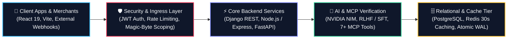

<div align="center">

<!-- HEADER BANNER -->


<!-- TYPING SVG SUBTITLE -->
<a href="https://github.com/adii1802">
  
</a>

<br/>

<!-- BADGES BAR -->
[](https://github.com/adii1802)
[](https://www.linkedin.com/in/aditya-gaur/)
[](mailto:adityagaur1802@gmail.com)
[](https://web.mitsgwalior.in/)
[](https://github.com/adii1802)

</div>

---

### ⚡ Executive Summary

> **"Enthusiastic Software Developer passionate about building reliable backend services, REST APIs, and database-driven applications using SQL, PostgreSQL, Node.js, Express.js, and Django REST Framework. Experienced in relational database design, query development, authentication, secure data handling, and API integration. Familiar with Docker, CI/CD fundamentals, and structured application workflows, with a strong problem-solving mindset and a commitment to writing maintainable, high-quality code. Eager to contribute to enterprise application development, troubleshooting, and continuous improvement while expanding expertise in C# and .NET Core."**

```
┌────────────────────────────────────────────────────────────────────────┐
│  "Reliable backends aren't built by accident; they are engineered      │
│   through atomic transactions, defensive validation, deterministic     │
│   state machines, and strict architectural contracts."                 │
└────────────────────────────────────────────────────────────────────────┘
```

---

### 🔭 About Me & Current Focus

- 🔭 **I’m currently working on:** High-concurrency backend services, state-machine driven onboarding pipelines, and Model Context Protocol (MCP) servers for LLM claim verification.
- 💼 **Recent Experience:**
  - **LLM Post Training Intern** @ *Ethara AI* — Post-training LLMs via RLHF & SFT in containerized Docker environments; evaluated 1,000+ data samples.
  - **Software Developer Intern** @ *CAIRNLOOP Technologies* — Architected core payout workflows and validation layers for an early-stage payment gateway serving 100+ users.
- 👯 **I’m looking to collaborate on:** Scalable open-source backend architectures, MCP ecosystem tooling, and distributed database services.
- 🤝 **I’m looking for help with:** Advanced distributed consensus algorithms, high-throughput message streaming (Kafka), and enterprise .NET Core microservices.
- 🌱 **I’m currently learning / exploring:** Enterprise application engineering with C# & .NET Core, advanced system design patterns, and low-latency API caching.
- 💬 **Ask me about:** Relational DB design (PostgreSQL/SQL), JWT/OAuth auth architectures, Django REST state machines, FastAPI, and RLHF/SFT pipelines.
- ⚡ **Fun fact:** I love turning ambiguous edge cases into rock-solid database constraints and deterministic state transitions!

---

### 🏆 Key Honors & Recognitions

- 🥇 **Winner — Hacksagon 2025 (National Hackathon, IIIT Gwalior)**: Built *SkillSync*, outperforming **100+ competing engineering teams** across India in an intensive 36-hour challenge.
- 🎖️ **Meritocracy Award**: Conferred for significant architectural and engineering contributions to quality improvement initiatives.
- 🌟 **Medhavi Vidyarthi Award (MMVY)**: Prestigious academic scholarship recognition awarded by the Government of Madhya Pradesh for top academic excellence.
- 🎓 **Academic Distinction**: B.Tech in Computer Science and Engineering at **Madhav Institute of Technology and Science (MITS), Gwalior** with a **9.0 / 10.0 GPA**.

---

### 🛠️ Backend, Distributed & AI Pipeline



---

### 🚀 Flagship Engineered Projects

<table>
  <tr>
    <td width="50%" valign="top">
      <h3 align="center">🛡️ KYC Pipeline – Merchant Onboarding</h3>
      <p align="center">
        <b>Production-Quality Merchant State Machine & Verification Engine</b><br/>
        <a href="https://github.com/adii1802/KYC_Pipeline"><code>Repo</code></a>
      </p>
      <ul>
        <li><b>Deterministic State Machine</b>: Engineered 3-phase flow (<code>draft</code> → <code>submitted</code> → <code>under_review</code> → <code>approved/rejected</code>) with an <code>at_risk</code> flag computed dynamically at serialization time with zero extra infrastructure.</li>
        <li><b>15+ REST APIs & Security</b>: Full auth, document upload, and reviewer queue with magic-byte file validation and strict tenant scoping (cross-merchant requests return 404).</li>
      </ul>
      <p align="center">
        
        
        
        
      </p>
    </td>
    <td width="50%" valign="top">
      <h3 align="center">🧠 HalluciGuard – AI Hallucination Detector</h3>
      <p align="center">
        <b>MCP Server & NVIDIA NIM Verification Engine</b><br/>
        <a href="https://github.com/adii1802/Hallucination_remover"><code>Repo</code></a>
      </p>
      <ul>
        <li><b>Model Context Protocol (MCP) Server</b>: Exposes 2 core tools (<code>detect_hallucination</code> and <code>audit_trace_budget</code>) to perform sentence-by-sentence claim verification and trust scoring across 4 AI clients.</li>
        <li><b>Interactive Analysis Engine</b>: FastAPI web interface with 4 verifier backends and 7+ MCP tools for real-time evidence-span management and verifiable LLM outputs.</li>
      </ul>
      <p align="center">
        
        
        
        
      </p>
    </td>
  </tr>
  <tr>
    <td width="50%" valign="top">
      <h3 align="center">📡 Content Broadcasting System</h3>
      <p align="center">
        <b>Role-Based Digital Screen Broadcasting Backend</b><br/>
        <a href="https://github.com/adii1802/content-broadcasting-system"><code>Repo</code></a>
      </p>
      <ul>
        <li><b>Role-Based Workflows</b>: Multi-role backend for distributing content across educational displays with teacher upload and principal approval queues.</li>
        <li><b>10+ REST APIs & Performance</b>: JWT authentication, Multer streaming, 30-second in-memory caching to drastically cut PostgreSQL query loads, and IP rate limiting (100 req/15 min).</li>
      </ul>
      <p align="center">
        
        
        
        
      </p>
    </td>
    <td width="50%" valign="top">
      <h3 align="center">💳 Payment Gateway Payout Engine</h3>
      <p align="center">
        <b>Transactional Payout Validation & Resilient Processing</b><br/>
        <a href="https://github.com/adii1802/Mock_Bank_payout"><code>Repo</code></a> • 
        <a href="https://github.com/adii1802/Socketio_chess"><code>Socket.io Chess</code></a>
      </p>
      <ul>
        <li><b>Core Payout Infrastructure</b>: Implemented backend APIs to validate payout requests, manage ledger states, and handle bank webhook edge cases.</li>
        <li><b>Real-Time Event Engines</b>: Experience building low-latency bidirectional socket microservices with Socket.io and Redis backplanes.</li>
      </ul>
      <p align="center">
        
        
        
        
      </p>
    </td>
  </tr>
</table>

---

### 💼 Professional Experience

```
┌────────────────────────────────────────────────────────────────────────────────────────┐
│ 🏢 Ethara AI (Green Rider Technology LLP)                  Dec 2025 – Mar 2026         │
│    Role: LLM Post Training Intern (RLHF / SFT)                                         │
│    • Spearheaded model behavior evaluation and post-training via RLHF & SFT in Python. │
│    • Validated & annotated 1,000+ data samples inside Docker containerized environments. │
│                                                                                        │
│ 🏢 CAIRNLOOP Technologies                                   May 2026 – Nov 2026        │
│    Role: Software Developer Intern (Backend & Payments)                                │
│    • Engineered backend payout service workflows for early-stage gateway (100+ users).  │
│    • Hardened transaction reliability with defensive validations and edge case recovery│
└────────────────────────────────────────────────────────────────────────────────────────┘
```

---

### 💻 Technical Arsenal & Tech Stack

<div align="center">

#### Programming Languages


#### Backend, Frameworks & APIs


#### AI / LLMs & MCP Ecosystem


#### Databases, DevOps & Cloud


</div>

---

### 📊 GitHub Activity & Metrics

<div align="center">
  
  
</div>

<div align="center" style="margin-top: 10px;">
  
</div>

---

### 🌐 Connect & Collaborate

<div align="center">

Open to backend engineering opportunities, distributed systems projects, and LLM / MCP collaborations!

<a href="https://github.com/adii1802">
  
</a>
&nbsp;
<a href="https://www.linkedin.com/in/aditya-gaur/">
  
</a>
&nbsp;
<a href="mailto:adityagaur1802@gmail.com">
  
</a>

<br/><br/>

<sub>Engineered with precision for Resilient Architectures & High-Concurrency Systems • <b>Aditya Gaur</b></sub>

</div>
